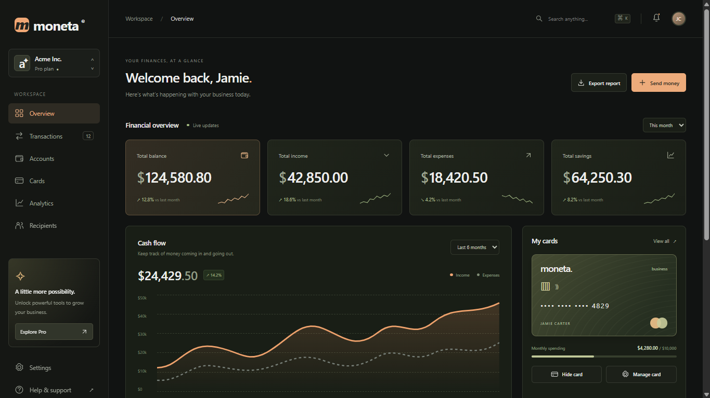
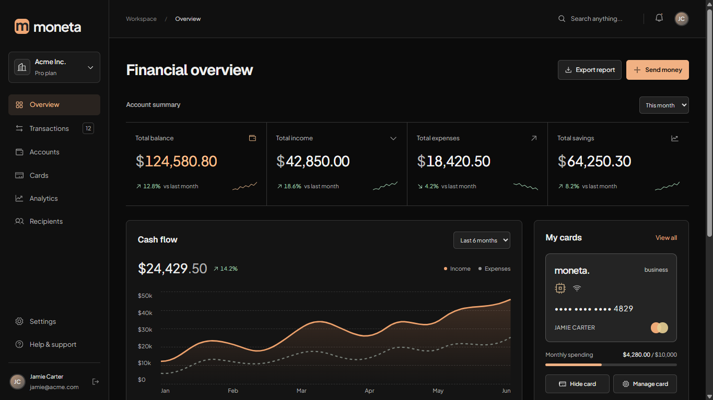

<p align="center">
  
</p>

<p align="center">
  Build and refine interfaces around your product's audience, content, and identity.
</p>

<p align="center">
  <picture><source media="(prefers-color-scheme: dark)" srcset="https://raw.githubusercontent.com/lobehub/lobe-icons/ea434b96e75813517b377825e01c0df61dee8836/packages/static-png/dark/codex.png"></picture>
  &nbsp;
  <picture><source media="(prefers-color-scheme: dark)" srcset="https://raw.githubusercontent.com/lobehub/lobe-icons/ea434b96e75813517b377825e01c0df61dee8836/packages/static-png/dark/opencode.png"></picture>
  &nbsp;
  <picture><source media="(prefers-color-scheme: dark)" srcset="https://raw.githubusercontent.com/lobehub/lobe-icons/ea434b96e75813517b377825e01c0df61dee8836/packages/static-png/dark/antigravity-color.png"></picture>
  &nbsp;
  <picture><source media="(prefers-color-scheme: dark)" srcset="https://raw.githubusercontent.com/lobehub/lobe-icons/ea434b96e75813517b377825e01c0df61dee8836/packages/static-png/dark/kiro-color.png"></picture>
  &nbsp;
  <picture><source media="(prefers-color-scheme: dark)" srcset="https://raw.githubusercontent.com/lobehub/lobe-icons/ea434b96e75813517b377825e01c0df61dee8836/packages/static-png/dark/cursor.png"></picture>
  &nbsp;
  <picture><source media="(prefers-color-scheme: dark)" srcset="https://raw.githubusercontent.com/lobehub/lobe-icons/ea434b96e75813517b377825e01c0df61dee8836/packages/static-png/dark/kilocode.png"></picture>
  &nbsp;
  <picture><source media="(prefers-color-scheme: dark)" srcset="https://raw.githubusercontent.com/lobehub/lobe-icons/ea434b96e75813517b377825e01c0df61dee8836/packages/static-png/dark/githubcopilot.png"></picture>
  &nbsp;
  <picture><source media="(prefers-color-scheme: dark)" srcset="https://raw.githubusercontent.com/lobehub/lobe-icons/ea434b96e75813517b377825e01c0df61dee8836/packages/static-png/dark/claudecode-color.png"></picture>
  &nbsp;
  <picture><source media="(prefers-color-scheme: dark)" srcset="https://raw.githubusercontent.com/lobehub/lobe-icons/ea434b96e75813517b377825e01c0df61dee8836/packages/static-png/dark/pi.png"></picture>
  &nbsp;
  <picture><source media="(prefers-color-scheme: dark)" srcset="https://raw.githubusercontent.com/lobehub/lobe-icons/ea434b96e75813517b377825e01c0df61dee8836/packages/static-png/dark/grok.png"></picture>
  &nbsp;
  <picture><source media="(prefers-color-scheme: dark)" srcset="https://raw.githubusercontent.com/lobehub/lobe-icons/ea434b96e75813517b377825e01c0df61dee8836/packages/static-png/dark/devin-color.png"></picture>
  &nbsp;
  <picture><source media="(prefers-color-scheme: dark)" srcset="https://raw.githubusercontent.com/lobehub/lobe-icons/ea434b96e75813517b377825e01c0df61dee8836/packages/static-png/dark/deepseek-color.png"></picture>
</p>

<p align="center">
  <a href="https://skills.sh/smokeeaasd/flawless-ui-ux/flawless-ui-ux"></a>
  <a href="https://www.npmjs.com/package/flawless-ui-ux"></a>
  <a href="https://www.npmjs.com/package/flawless-ui-ux"></a>
  <a href="LICENSE"></a>
</p>

<p align="center">
  <a href="#what-is-flawless-ui-ux">About</a> ·
  <a href="#without-skill-vs-with-skill">Comparison</a> ·
  <a href="#install">Install</a> ·
  <a href="#update-and-diagnose-installations">Update</a> ·
  <a href="#use-the-skill">Use the skill</a> ·
  <a href="#how-it-works">How it works</a> ·
  <a href="#inspect-and-verify">Inspect and verify</a> ·
  <a href="#documentation">Docs</a>
</p>

## What is flawless-ui-ux?

flawless-ui-ux is a UI/UX design skill and a local inspection CLI for coding agents. It helps agents create, redesign, refine, and review interfaces around a product's audience, content, and identity.

The skill guides layout, typography, color, and interaction decisions for web, native mobile, and desktop interfaces. The CLI inspects selected source files and browser interfaces, providing observations the agent can use to find issues and verify corrections. You describe the task; your coding agent applies the guidance in your existing project.

## Without skill vs. with skill

<table>
  <tr>
    <th width="50%">Without skill</th>
    <th width="50%">With skill</th>
  </tr>
  <tr>
    <td></td>
    <td></td>
  </tr>
</table>

Created in Codex with GPT 6.1 Sol (low), then refined with flawless-ui-ux using the same model and reasoning setting.

## Install

From your project directory, run one command with your preferred package manager:

```bash
# npm
npx flawless-ui-ux@latest install

# pnpm
pnpm dlx flawless-ui-ux@latest install

# Bun
bunx flawless-ui-ux@latest install
```

Requires **Node 22.12+**. In a terminal, choose **project or global scope**, select **one or more agents**, and **confirm the destinations** before copying. Use Space to select and Enter to continue. Ctrl+C cancels before installation files are written.

Explicit flags run directly:

```bash
npx flawless-ui-ux install --codex
npx flawless-ui-ux install --codex --devin
npx flawless-ui-ux install --claude-code --global
npx flawless-ui-ux install --project ./app
npx flawless-ui-ux install --yes
```

`--yes` skips the menu and uses the defaults when no other flags are supplied: all supported agents in the current project. JSON output, CI, and non-terminal execution remain noninteractive. Use `--format json` for machine-readable output.

<details>
<summary>Install the skill through skills.sh</summary>

```bash
npx skills add smokeeaasd/flawless-ui-ux --skill flawless-ui-ux
```

This installs the skill through the [Skills CLI](https://github.com/vercel-labs/skills). Its runtime requirements and agent selection follow that installer. The inspection CLI is available separately through the npm commands in this guide.

</details>

<details>
<summary>Install from a checkout with Bash</summary>

```bash
bash /absolute/path/flawless-ui-ux/install.sh --codex --project
```

The alternative supports Bash 3.2 and newer. It requires `--project` for local installation; its default is global. Windows users need Git Bash or WSL. It copies the skill only; the npm package supplies the CLI commands.

</details>

## Update and diagnose installations

Updating the npm package does not replace skill copies already installed for your agents. Preview changes, then update those copies from the running package:

```
npx flawless-ui-ux@latest update --codex --dry-run
npx flawless-ui-ux@latest update --codex
npx flawless-ui-ux@latest update --global --claude-code
```

Without agent flags, `update` checks all supported destinations in the selected scope. Missing copies are skipped. Modified, unrecognized, linked, or newer copies stop the entire selected update before any installation changes. Keep local edits and reconcile them manually; there is no force overwrite. Clean 2.0.0 copies are recognized by their file hashes. CLI installs and updates record the package version and file hashes in `.flawless-install.json` inside the skill directory, separate from your product/design Markdown. Bash and third-party installs may lack this record; exact recognized contents can still be adopted.

Check local and global copies and browser availability:

```
npx flawless-ui-ux@latest doctor --codex
npx flawless-ui-ux@latest doctor --global --format json
```

`doctor` reports paths, recorded versions, modifications, divergent copies, runtime dependencies, and a browser launch probe. A missing browser is advisory for source-only work. It does not download a browser, change agent settings, or establish that a skill is loaded in an active session. Both commands support the install agent flags and `--project`; only `--global` selects global updates. See the [maintenance contract](docs/cli-contract.md#update-and-doctor).

## Use the skill

Describe the interface you need and name the skill:

```text
Use the flawless-ui-ux skill to build a financial dashboard for freelancers.
```

In Codex, invoke `$flawless-ui-ux`. Hosts with slash commands use `/flawless-ui-ux`; Pi uses `/skill:flawless-ui-ux`. You can also request the skill by name through your host's skill mechanism. Start a new session after installation if discovery needs to refresh.

Continue in the same conversation as the interface develops:

| Task | Example request |
|---|---|
| Create | Build a landing page for an app that coordinates deployments and incident handoffs. |
| Redesign | Redesign this account screen for mobile using the supplied brand palette. Preserve its content and behavior. |
| Refine | Give the main action more presence while preserving the page's visual character. |
| Focus | Improve typography and spacing. Preserve wording, colors, and functionality. |
| Review | Review this dashboard for readability, navigation, accessibility, and repeated generic patterns. Report findings without editing files. |

## How it works

**The skill guides design and implementation.** It connects product context to composition, typography, color, density, imagery, and interaction. Focused references support creation, redesign, refinement, and review in your existing stack.

For new interfaces and broad redesigns, the agent considers at least three meaningfully different compositions internally before implementation, then chooses an approach for the product and task. Focused refinements preserve the authorized scope and established decisions.

The design guidance applies to web, native mobile, and desktop interfaces. The CLI's rendered checks cover browser interfaces; native verification uses appropriate platform and project tools.

**Refinement develops the intended character.** An interface may need more presence, less competing emphasis, or a more consistent finish. The right intervention depends on the content and task. Generic copy, repetitive decoration, and familiar patterns are reviewed in context, alongside usability and accessibility.

**The CLI checks the implementation.** Collect project context, inspect selected source files or a running interface, and compare the result after corrections. Your agent makes the changes; the CLI provides observations and records what was actually checked.

## Product context and workflows

Keep product facts and design decisions in your existing Markdown documents. The agent reuses them across tasks; context files are optional. Use `context --source docs/brief.md` to select a document outside the conventional locations.

To prepare missing records, run:

```
npx flawless-ui-ux init
```

The CLI creates product/design Markdown templates or reuses supported existing documents, preserving their content. Your agent fills the records from the project and your decisions. Read them later with `context`; initialization does not generate a brief or choose a visual style.

Inspect related screens with repeated `--url` inputs and `--consistency` for a contextual style inventory. Add `--flow flows/edit-member.json` to exercise explicitly defined UI actions, expectations, and named states in a permitted test environment. Verification requires the unchanged flow file to be selected again. See [workflow examples and limits](docs/product-aware-workflows.md).

## Inspect and verify

Use the CLI directly, or ask your agent to include these checks in its work. Replace `npx` with `pnpm dlx` or `bunx` throughout.

### Optional visual report

Add `--html` with a new output directory to inspect or verify:

```
npx flawless-ui-ux inspect --url http://localhost:5173 --output ./inspection-before --html
npx flawless-ui-ux verify ./inspection-before/run.json --output ./inspection-after --html
```

Open `report.html` from the output directory. It shows findings, evidence, coverage, captured screens, and verification differences without a server or external services. Screenshots remain adjacent files; keep the output directory together when sharing it. Reports can contain your interface content and project paths. The HTML is an additional view of the same observations, not a design score or full accessibility certification. Omit `--html` to retain the existing JSON artifact behavior.

### Start with context and source

```bash
npx flawless-ui-ux context --project . --format json
npx flawless-ui-ux inspect --project . --source src/App.tsx --format json
```

### Check the running interface

Start your app and prepare the browser once:

```bash
npx playwright@1.64.1 install chromium
# or: pnpm dlx playwright@1.64.1 install chromium
# or: bunx playwright@1.64.1 install chromium
```

Inspect the actual development-server URL and save a baseline:

```bash
npx flawless-ui-ux inspect --project . --source src/App.tsx --url http://localhost:5173 --output ../app-before --format json
```

After corrections, repeat the saved scope:

```bash
npx flawless-ui-ux verify ../app-before/run.json --output ../app-after --format json
```

The comparison separates **persistent**, **new**, and **no-longer-observed** findings. Missing confirmed targets and changed conditions remain unverified.

| Area | Evidence collected |
|---|---|
| Accessibility | Selected axe contrast and accessible-name rules, including incomplete results for review |
| Text and layout | Computed font sizes and horizontal overflow at the sampled widths |
| Assets and runtime | Visible broken images and uncaught JavaScript errors |
| Copy and icons | Exact repeated phrases and arrow cues for contextual review |
| Source | Literal pixel font sizes and arrow/icon cues in selected files |

<details>
<summary>Scope, artifacts, and verification limits</summary>

- Default viewport samples are **1440 × 900** and **390 × 844**. Repeat `--viewport WIDTHxHEIGHT` to choose others.
- Repeat `--source` for additional files, or use `--selector` to inspect a region.
- Use `--browser-executable` or `FLAWLESS_BROWSER_EXECUTABLE` to select an installed compatible Chromium. Keep browser conditions consistent between runs.
- With `--output`, a new directory receives `run.json` and available screenshots; its parent must exist. Existing output directories are preserved. Without it, results go to stdout.
- Add `--html` to include an offline `report.html` in that directory, with the same findings and coverage.

These samples do not establish full WCAG conformance, complete keyboard journeys, business-flow correctness, or visual quality. Explicit flows cover only their selected actions and expectations. Small text and repetition require context. Ordinary inspection does not perform UI actions or submit forms. Explicit flows run selected actions with network-write and popup blocking. Inspection does not edit files, start servers, or download browsers.

CLI exit codes: `0` for completed coverage without confirmed errors, `1` for completed coverage with confirmed errors, and `2` for invalid input or incomplete requested coverage. The installer also returns `0` when confirmation is declined and `130` when a prompt is interrupted.

</details>

## Installation notes

`install` preserves existing destinations. Use `update` for recognized unmodified copies; keep and reconcile custom changes before explicitly reinstalling. Host rules, plugins, permissions, and trust settings stay under your control.

The twelve supported agents use **five project copies** of the same skill. Hosts that discover `.agents/skills` share one copy; others use their native directories.

<details>
<summary>Host-specific details</summary>

- **Grok Build:** project skills become available after folder trust.
- **DeepSeek Harness:** install from the nearest Git root, or the working directory without Git. Custom provider roots may change discovery.
- **Kiro:** custom agents can reference skills through `skill://` resources.
- **Global paths:** honor each host's configuration directory and overrides. Devin uses `APPDATA` on Windows and `XDG_CONFIG_HOME` elsewhere.

See the [installation contract](docs/cli-contract.md#install) for exact paths and the [testing guide](docs/testing.md) for recorded compatibility evidence and pending checks.

</details>

## Development

```bash
bun install --frozen-lockfile
bun test
```

Bun is the development toolchain; the published CLI runs on Node. See [testing](docs/testing.md) for browser fixtures, packaging checks, and Windows/Ubuntu CI.

## Documentation

- [2.0 migration](docs/migration-2.md) — report schema changes and compatibility
- [Product-aware workflows](docs/product-aware-workflows.md) — Markdown context, selected flows, and cross-screen evidence
- [Workflow guide](docs/workflow-procedures.md) — creation, redesign, refinement, and review
- [CLI contract](docs/cli-contract.md) — installation paths, options, context, and comparison limits
- [Product contract](docs/product-contract.md) — philosophy and scope
- [Architecture](docs/skill-architecture.md) — skill, project context, and inspection core
- [Manual evaluations](evals/README.md) — reproducible tasks and evidence criteria
- [Changelog](CHANGELOG.md)

## License

[MIT](LICENSE).

Agent icons are provided by [Lobe Icons](https://github.com/lobehub/lobe-icons), using theme-aware images pinned to a specific revision. Product names and marks belong to their respective owners. Badges use [Shields.io](https://shields.io). Monthly downloads refer to the npm CLI package.
