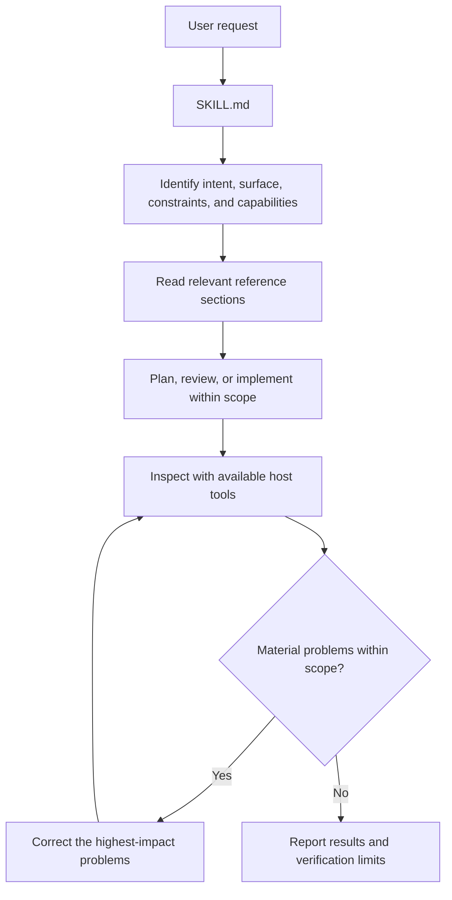

# Skill architecture

Architecture baseline defined on November 3, 2026. This document translates the [product contract](product-contract.md) into package boundaries, reference responsibilities, and loading rules. The initial package implements this structure; current verification and host evaluation status are recorded in the [project overview](../README.md#validation-status).

The next content revision is defined by the [workflow procedures](workflow-procedures.md). It adds complete intervention procedures and task-specific guidance to the shared package. That revision is specified but not yet implemented in the installed skill.

## 1. Architecture decisions

| Decision | Rationale |
|---|---|
| One skill named `flawless-ui-ux` | Users describe their goal in ordinary language through one entry point. |
| One shared package for OpenCode and Codex | Design guidance stays consistent across hosts. |
| A concise `SKILL.md` and six supporting references | Shared decisions are immediately available; conditional detail is loaded when useful. |
| Guidance selected by intent and surface purpose | A landing page, dashboard, and reading experience need different treatment, as do creation and refinement. |
| Host-provided editing, browser, and image capabilities | The skill does not need an execution engine or browser integration of its own. |
| Session-local working context by default | Small tasks do not create documentation or hidden project state automatically. |
| Existing project conventions govern implementation | The package provides design guidance without imposing a framework, component library, or visual preset. |

The runtime is the host coding agent. The skill supplies instructions and references; the host selects tools, executes changes, and observes the result within its available capabilities.

## 2. Package and repository boundaries

The current installable package is:

```text
skills/
└── flawless-ui-ux/
    ├── SKILL.md
    ├── agents/
    │   └── openai.yaml
    └── references/
        ├── context.md
        ├── direction.md
        ├── surfaces.md
        ├── craft.md
        ├── interaction.md
        └── review.md
```

These eight files form the initial installable package. The [procedure implementation target](workflow-procedures.md#7-package-implementation-target) adds four conditional workflow guides and three task guides in the next revision. The planned fifteen-file package remains self-contained. Do not create empty scaffolds for future resources.

| Location | Responsibility | Included in installation |
|---|---|---|
| `skills/flawless-ui-ux/` | Complete portable skill and its supporting resources | Yes |
| `docs/` | Maintained product and architecture decisions | No |
| Root `README.md`, `CHANGELOG.md`, `LICENSE`, and `CONTRIBUTING.md` | Project overview, release history, license, and contribution workflow | Not copied as skill instructions |
| Root `install.sh` | Copy the self-contained package into a host's discovery directory | Installer only |
| `.github/` | Repository checks and configuration | No |
| `evals/` | Manual evaluation requests, fixtures, rubric, and report template; host runs remain pending | No |
| Parent workspace | Research, exploratory notes, and temporary working material | No |

The installed folder must work without access to the source repository or its parent workspace. Runtime instructions must not depend on `docs/`, `evals/`, or external research notes. Supporting links resolve relative to the installed skill directory or the reference containing them.

No `scripts/` or `assets/` directory is required initially. Add an asset only when there is a real output resource to copy or adapt. Add a script only for a demonstrated repeated operation that existing host tools cannot reliably handle. Instruction examples and direction criteria belong in references.

## 3. Entry point: SKILL.md

The entry point owns discovery, shared decision criteria, and reference selection. Use the common frontmatter fields:

```yaml
---
name: flawless-ui-ux
description: Create, redesign, refine, or review web interfaces with contextual art direction and UI/UX guidance.
---
```

The name matches the containing folder. Discovery metadata should remain short and describe requests that actually require interface design. Backend-only changes and repository administration do not need this skill.

The body contains:

1. The intended outcome and the boundary of the requested work.
2. How to identify intent, surface purpose, existing visual constraints, and available evidence.
3. The adaptive workflow: understand, define direction, implement, observe, and correct.
4. Direct links to references, with clear conditions for loading each one.
5. Essential constraints about preserving explicit requirements, factual content, scope, and verification honesty.
6. Delivery expectations proportional to the task.

Detailed typography rules, examples, state handling, and review procedures live in their owning references. The entry point does not duplicate them or require every reference to be read for every task.

## 4. Reference responsibilities

| Reference | Owns | Load when |
|---|---|---|
| `context.md` | Extracting the product brief; inspecting existing visual decisions, content, assets, and constraints; separating facts from assumptions | A new surface, redesign, or significant gap in project understanding requires investigation |
| `direction.md` | Developing a product-specific concept; comparing useful alternatives; composing the page argument; choosing visual roles and imagery | Creating a visual direction or intentionally replacing one |
| `surfaces.md` | Purpose-specific priorities for persuasion, task execution, reading, and exploration | The surface's purpose changes composition or interaction decisions; read its relevant section |
| `craft.md` | Hierarchy, typography, layout, spacing, color, imagery, and responsive composition | Implementing or refining those visual aspects; read the relevant sections |
| `interaction.md` | UX writing, controls, semantics, accessibility, motion, and relevant loading, empty, success, and error states | The request affects interaction, comprehension, accessibility, or state behavior |
| `review.md` | Prioritized critique, rendered inspection, interaction evidence, correction order, and reporting | Reviewing an existing interface or checking the result of a change |

Each reference explains its purpose, decision criteria, concrete failure signals, and useful corrective approaches. Examples should clarify a decision rather than prescribe a universal layout.

### Ownership rules

- `context.md` establishes what is true and what must remain; `direction.md` decides how to express it.
- `surfaces.md` establishes priorities for the visitor's job; `craft.md` and `interaction.md` address execution.
- Responsive composition belongs in `craft.md`; responsive control behavior belongs in `interaction.md`.
- `review.md` owns review and evidence reporting. Other references can link to it instead of repeating its procedure.
- Shared guarantees stay in `SKILL.md`. A reference adds only the detail relevant to its subject.

Cross-links are allowed, but must not form a chain that requires reading the entire package to complete an ordinary task. References should link directly to the section needed.

## 5. Intent and surface selection

Intent describes the requested intervention. Surface purpose describes what the visitor needs to accomplish. Both can usually be inferred from the request and existing interface; they are internal decisions, not a command catalog.

The next revision also selects relevant task guidance for data interfaces, forms and journeys, or content interfaces. These concerns compose: a subscription screen can use creation, task-execution priorities, and forms-and-journeys guidance while inheriting an existing identity. The [selection rules](workflow-procedures.md#1-operating-model) define mixed requests, planning-only work, review with authorized fixes, and proportional loading.

| Intent | Expected behavior |
|---|---|
| Create | Establish missing context, choose a suitable direction, build the requested interface, and review it |
| Redesign | Inspect the incumbent interface, preserve valid product and functional constraints, and deliberately replace the permitted visual decisions |
| Refine | Improve the named target while preserving identity, behavior, and everything outside scope |
| Review | Inspect and report prioritized findings; implement fixes only when the request authorizes them |

The surface-purpose sections are:

- **Persuasion:** communicate value and support an informed next action.
- **Task execution:** prioritize legibility, density, navigation, states, and efficient work.
- **Reading:** prioritize comprehension, information structure, and sustained readability.
- **Exploration:** let the work or content lead and keep navigation understandable.

A mixed page can have a dominant purpose and embedded interfaces with a different purpose. A marketing page containing an application preview should retain a coherent visual identity while treating the preview's controls and data as a working interface.

## 6. Adaptive loading and execution

The initial package follows this shared loop:



Loading examples:

| Request | Likely reference path | Expected depth |
|---|---|---|
| Build a new product page | Context → relevant surface → direction → relevant craft/interaction sections → review | A complete direction and implementation cycle |
| Redesign a dashboard while preserving its workflows | Context → task-execution section → direction → relevant craft/interaction sections → review | Establish what can change before replacing visual decisions |
| Improve the heading hierarchy | Typography in craft → focused review | Reuse the existing direction; avoid unrelated redesign |
| Improve form errors on mobile | Relevant interaction sections → responsive craft if layout changes → focused review | Handle wording, states, keyboard behavior, and layout as needed |
| Critique a pricing page | Persuasion section and review; other sections only to investigate findings | Prioritized findings without unrequested edits |

These are examples, not mandatory reading sequences. Once context or a reference section is already available and current, reuse it. New evidence can justify reading another section.

In the next revision, the entry point selects a primary workflow, applicable task-guide sections, and needed subject references. The [procedures](workflow-procedures.md#3-primary-procedures) define the decisions and completion criteria inside the loop; [task guidance](workflow-procedures.md#4-task-specific-guidance) specializes them for the work behind the interface. Narrow requests can omit task guidance when subject references suffice. No routing chain should require loading the entire package.

The correction loop ends when the task's material issues are resolved or a concrete limitation prevents further verification or correction. Report the remaining limitation; do not repeatedly redesign the interface to satisfy a subjective score. The skill does not impose a fixed screenshot count, animation quota, or universal design score.

## 7. Working context and outputs

Working context normally stays in the host's existing notes or conversation. Its depth scales with the task:

| Working record | Useful content |
|---|---|
| Brief | Target, user task, desired outcome, implementation constraints, existing identity, available content/assets, confirmed facts, and assumptions |
| Direction | Product-specific concept, composition, visual roles, imagery approach, interaction intent, and responsive behavior |
| Solution outline | Information order, required actions and state transitions, integration boundary, and relevant acceptance cases |
| Review findings | Observed issue, location, effect on the user, priority, recommended correction, and evidence |
| Verification summary | What was rendered, inspected, interacted with, or checked; what remains unverified |

These are information contracts, not required JSON schemas or files. A small edit may need only a short note.

Reuse existing project documentation for durable product and visual decisions. Persist new decisions when the user requests documentation or the work calls for maintaining an established project record. Do not automatically create a new configuration file, hidden state directory, product brief, or full report for every request.

The final response should focus on the result, material decisions, meaningful verification, and unresolved limitations. A short change should receive a short report.

## 8. Host capabilities and installation

The shared instructions refer to capabilities rather than hard-coded tool names:

| Capability | Use | When unavailable |
|---|---|---|
| Read project files | Understand constraints, content, components, and styles | Use supplied material and identify missing evidence |
| Edit files and execute project commands | Implement and run applicable checks | Deliver the authorized plan or review and describe the implementation limitation |
| Render and inspect browser pages | Observe desktop/mobile layouts and actual interface states | Perform useful static review without claiming rendered verification |
| View images | Inspect screenshots, supplied references, and available assets | Explain which visual judgments could not be established |
| Search or generate imagery | Support the chosen direction when assets are needed and the capability is available | Adapt the direction to honest existing resources |

Host permissions remain authoritative. The skill does not install browser tools, configure external services, require a particular model, or assume paid capabilities are available. Rendered screenshots and interaction tests provide different evidence; neither should be claimed solely from reading source code.

The OpenAI skill model supports instructions with optional references and assets loaded as needed. The package uses that structure without requiring an MCP server. [OpenAI skill documentation](https://developers.openai.com/plugins/concepts/skills).

OpenCode supports directory-based skills and supporting files loaded when the instructions require them. Its documented native discovery directories are compatible with installing the same package without rewriting the design guidance. Invocation syntax differs between host versions, so shared instructions do not prescribe a specific loader call. [OpenCode V1 skills](https://opencode.ai/docs/skills), [OpenCode V2 skills](https://opencode.ai/v2/docs/skills).

`agents/openai.yaml` is host-facing presentation metadata for Codex: display name, short description, and an example prompt. It does not contain a second workflow or require separate design instructions. Keep normal automatic discovery enabled. No plugin manifest, generated provider copies, or separate adapter package is needed initially.

The existing root installer already targets `skills/flawless-ui-ux/`. During implementation, verify that it copies the complete folder, preserves relative references, respects existing installations, and works in the supported Bash environments. Installed behavior still requires a real host test; a copied folder alone does not establish support.

## 9. Evaluation and maintenance

Evaluation belongs outside the installed package. The [manual evaluation kit](../evals/README.md) contains concrete cases and fixtures; recorded host runs remain pending. The [procedure acceptance criteria](workflow-procedures.md#8-delivery-and-acceptance) extend this foundation to observable complete workflows and task-specific decisions.

The initial evaluation set should cover:

1. A new promotional page with enough product information to establish a specific direction.
2. A dashboard refinement that must preserve workflow, data meaning, and identity.
3. A focused typography change that should not expand into a redesign.
4. A review-only request that should produce actionable findings without edits.
5. A brand that intentionally uses a commonly discouraged visual treatment.
6. An environment without browser access, where verification claims must remain accurate.

Observe task completion, scope control, relevant reference use, coherence, usability, and verification honesty. Compare results with and without the skill using similar model settings and execution budgets. Self-assigned visual scores are supporting judgments, not proof of quality.

Package checks should validate metadata, resolvable internal references, and installation integrity. These are maintenance checks for the skill, not a deterministic interface detector. Document the host version, model, and capabilities used for behavioral evaluations. Additional agent support follows demonstrated behavior rather than file-format assumptions.

Update the root changelog and release tag when distributing changes to instructions or resources. Maintain one source package and avoid introducing host-specific copies unless testing demonstrates an actual need.

## 10. Procedure evolution

1. **Define:** specify intervention procedures, task selection, preservation boundaries, working outputs, and evidence and completion criteria in [workflow-procedures.md](workflow-procedures.md).
2. **Implement:** revise the entry point, add the conditional workflow and task guides, and deepen subject guidance and examples where those procedures need them. Preserve automatic discovery, shared host content, and package integrity.
3. **Evaluate and consolidate:** exercise complete tasks and focused interventions in both hosts, correct observed failures, and document actual results and remaining limits.

This documentation delivers the definition phase. Runtime implementation and observed workflow outcomes follow separately. The installable package must remain independent of repository documentation and use host-provided capabilities throughout.
